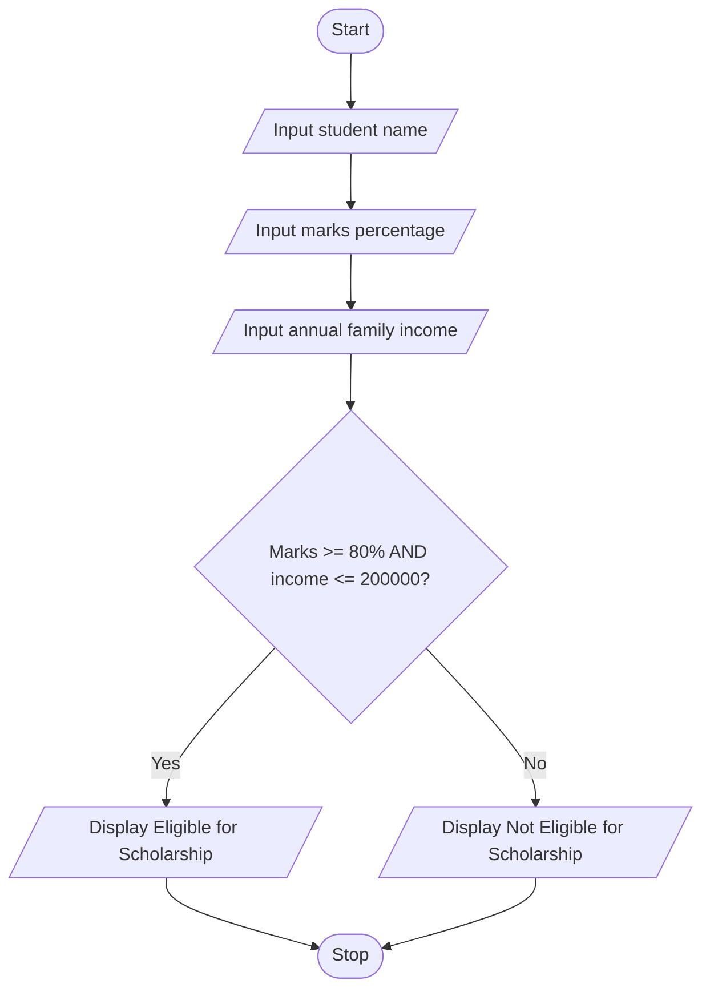

# Problem Statement
Develop a Python program to allocate scholarships to students based on their marks and annual family income. The program should accept the student's name, marks percentage, and annual family income as input. If the student meets the eligibility criteria of securing at least 80% marks and having an annual family income of ₹2,00,000 or less, the program should display that the student is eligible for a scholarship. Otherwise, it should display that the student is not eligible.
# Algorithm
1. Start.
2. Read the student's name.
3. Input the student's marks percentage.
4. Input the student's annual family income.
5. Check whether marks are greater than or equal to 80% and family income is less than or equal to ₹2,00,000.
6. If both conditions are true, display "Eligible for Scholarship."
7. Otherwise, display "Not Eligible for Scholarship."
8. Stop.
# Mermaid Flowchart

# Input Source Code (Python)

# University Scholarship Allocation

name = input("Enter student name: ")
marks = float(input("Enter marks percentage: "))
income = float(input("Enter annual family income: "))

if marks >= 80 and income <= 200000:
    print(name, "is Eligible for Scholarship")
else:
    print(name, "is Not Eligible for Scholarship")

# Sample Input and Output
Input:
Enter student name: Charitha
Enter marks percentage: 85
Enter annual family income: 150000

Output:
Charitha is Eligible for Scholarship
