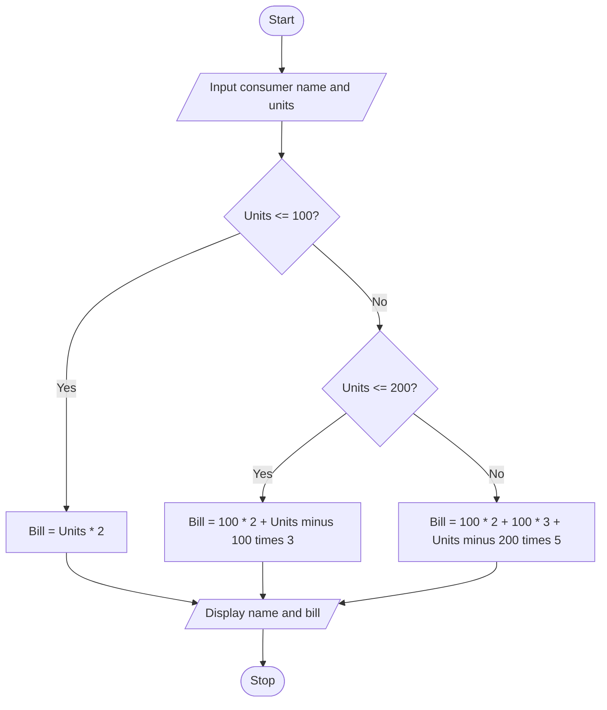

# Problem Statement
Develop a Python program to calculate an electricity bill based on the number of units consumed using a progressive billing system. The program should accept the consumer's name and electricity units consumed as input. The bill is calculated using different rates for different consumption slabs:
- First 100 units: ₹2 per unit
- Next 100 units (101–200): ₹3 per unit
- Above 200 units: ₹5 per unit
The program should calculate and display the total electricity bill based on the units consumed.
  # Algorithm
1. Start.
2. Input the consumer's name.
3. Input the number of electricity units consumed.
4. If units are less than or equal to 100, calculate the bill at ₹2 per unit.
5. If units are between 101 and 200, calculate the first 100 units at ₹2 per unit and the remaining units at ₹3 per unit.
6. If units are above 200, calculate the first 100 units at ₹2 per unit, the next 100 units at ₹3 per unit, and the remaining units at ₹5 per unit.
7. Display the consumer's name and total electricity bill.
8. Stop.
# Mermaid Flowchart

# Input Source Code (Python)

# Progressive Electricity Billing

name = input("Enter consumer name: ")
units = int(input("Enter units consumed: "))

if units < 0:
    print("Invalid units")
elif units <= 100:
    bill = units * 2
    print("Consumer Name:", name)
    print("Electricity Bill: Rs.", bill)
elif units <= 200:
    bill = (100 * 2) + ((units - 100) * 3)
    print("Consumer Name:", name)
    print("Electricity Bill: Rs.", bill)
else:
    bill = (100 * 2) + (100 * 3) + ((units - 200) * 5)
    print("Consumer Name:", name)
    print("Electricity Bill: Rs.", bill)

# Sample Input and Output
Input:
Enter consumer name: Charitha
Enter units consumed: 250

Output:
Consumer Name: Charitha
Electricity Bill: Rs. 650

Calculation:
- First 100 units: \(100 \times 2 = ₹200\)
- Next 100 units: \(100 \times 3 = ₹300\)
- Remaining 50 units: \(50 \times 5 = ₹250\)
Total bill = ₹200 + ₹300 + ₹250 = ₹750

Correction: The correct output for 250 units is ₹750, not ₹650.
