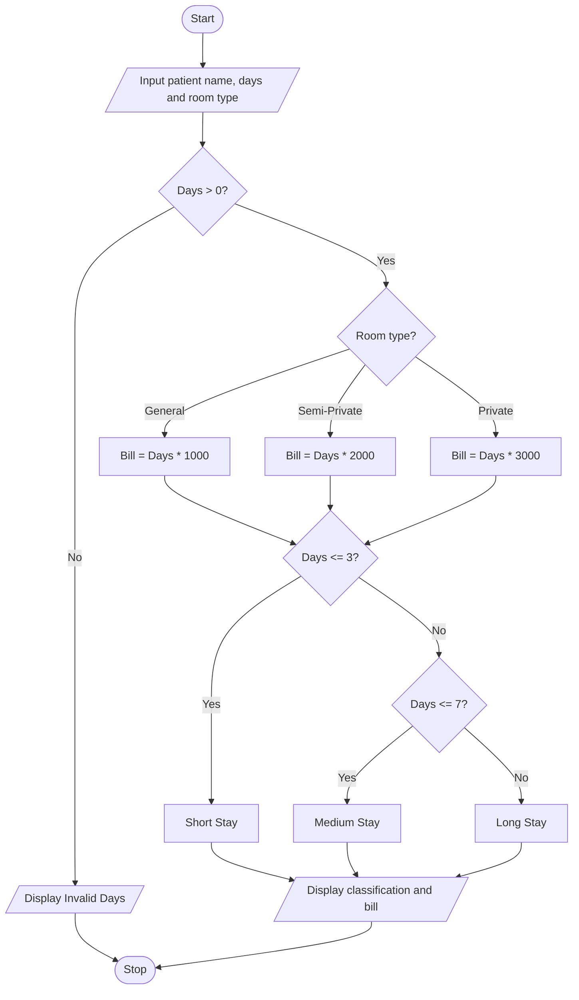

# Problem Statement
Develop a Python program to calculate a patient's hospital bill and classify the patient based on the number of days admitted. The program should accept the patient's name, number of days admitted, and room type as input. The hospital charges are calculated based on the room type selected.
- General Ward: ₹1,000 per day
- Semi-Private Room: ₹2,000 per day
- Private Room: ₹3,000 per day
The patient is classified as:
- Short Stay: 1–3 days
- Medium Stay: 4–7 days
- Long Stay: More than 7 days
The program should display the patient's name, stay classification, and total hospital bill.
  # Algorithm
1. Start.
2. Input the patient's name.
3. Input the number of days admitted.
4. Input the room type.
5. Check whether the number of days is valid.
6. Calculate the bill based on the selected room type.
7. Classify the patient based on the number of days admitted:
   - If days are less than or equal to 3, classify as Short Stay.
   - If days are between 4 and 7, classify as Medium Stay.
   - If days are greater than 7, classify as Long Stay.
8. Display the patient's name, classification, and total bill.
9. Stop.
# Mermaid Flowchart

 # Input Source Code (Python)

# Hospital Billing and Patient Classification

name = input("Enter patient name: ")
days = int(input("Enter number of days admitted: "))

print("Room Types: General, Semi-Private, Private")
room = input("Enter room type: ").lower()

if days <= 0:
    print("Invalid number of days")

elif room == "general":
    bill = days * 1000

elif room == "semi-private":
    bill = days * 2000

elif room == "private":
    bill = days * 3000

else:
    bill = 0
    print("Invalid room type")

if days > 0 and room in ["general", "semi-private", "private"]:
    if days <= 3:
        category = "Short Stay"
    elif days <= 7:
        category = "Medium Stay"
    else:
        category = "Long Stay"

    print("\nPatient Name:", name)
    print("Patient Classification:", category)
    print("Total Hospital Bill: Rs.", bill)

# Sample Input and Output
Input:
Enter patient name: Charitha
Enter number of days admitted: 5
Room Types: General, Semi-Private, Private
Enter room type: private

Output:
Patient Name: Charitha
Patient Classification: Medium Stay
Total Hospital Bill: Rs. 15000

Calculation:

Number of days = 5

Room type = Private

Daily charge = ₹3,000

Total bill = 5 × ₹3,000 = ₹15,000
