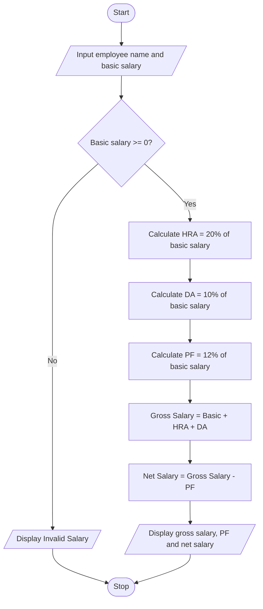

# Problem Statement
Develop a Python program to calculate an employee's net salary based on the basic salary and deductions. The program should accept the employee's name and basic salary as input. Calculate the HRA (House Rent Allowance) as 20% of the basic salary, DA (Dearness Allowance) as 10% of the basic salary, and PF (Provident Fund) deduction as 12% of the basic salary. The gross salary is the sum of basic salary, HRA, and DA. The net salary is calculated by subtracting PF from the gross salary. Finally, display the employee's name, gross salary, deductions, and net salary.
# Algorithm
1. Start.
2. Input the employee's name.
3. Input the basic salary.
4. Calculate HRA = 20% of basic salary.
5. Calculate DA = 10% of basic salary.
6. Calculate PF deduction = 12% of basic salary.
7. Calculate gross salary = Basic salary + HRA + DA.
8. Calculate net salary = Gross salary − PF deduction.
9. Display the employee's name, gross salary, PF deduction, and net salary.
10. Stop.
# Mermaid Flowchart

# Input Source Code (Python)

# Employee Payroll and Deduction Analysis

name = input("Enter employee name: ")
basic_salary = float(input("Enter basic salary: Rs. "))

if basic_salary < 0:
    print("Invalid salary")
else:
    hra = basic_salary * 0.20
    da = basic_salary * 0.10
    pf = basic_salary * 0.12

    gross_salary = basic_salary + hra + da
    net_salary = gross_salary - pf

    print("\nEmployee Name:", name)
    print("Basic Salary: Rs.", round(basic_salary, 2))
    print("HRA: Rs.", round(hra, 2))
    print("DA: Rs.", round(da, 2))
    print("Gross Salary: Rs.", round(gross_salary, 2))
    print("PF Deduction: Rs.", round(pf, 2))
    print("Net Salary: Rs.", round(net_salary, 2))

# Sample Input and Output
Input:
Enter employee name: Charitha
Enter basic salary: Rs. 20000

Output:
Employee Name: Charitha
Basic Salary: Rs. 20000.0
HRA: Rs. 4000.0
DA: Rs. 2000.0
Gross Salary: Rs. 26000.0
PF Deduction: Rs. 2400.0
Net Salary: Rs. 23600.0

Calculation:
- HRA = 20% × ₹20,000 = ₹4,000
- DA = 10% × ₹20,000 = ₹2,000
- PF = 12% × ₹20,000 = ₹2,400
- Gross salary = ₹20,000 + ₹4,000 + ₹2,000 = ₹26,000
- Net salary = ₹26,000 − ₹2,400 = ₹23,600
