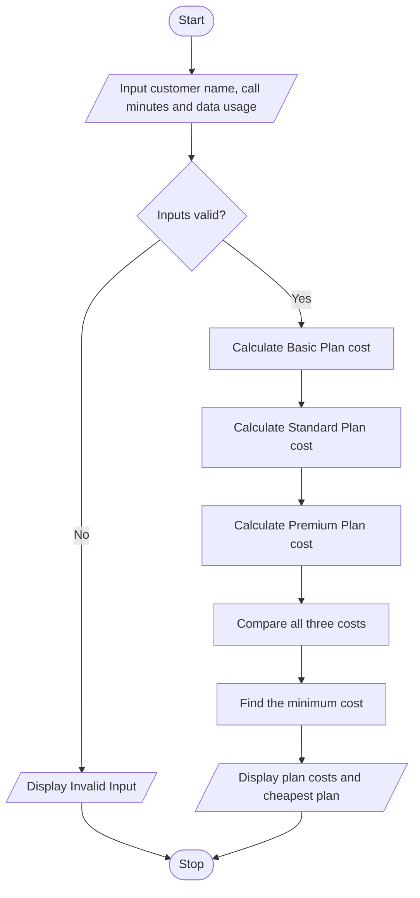

# Problem Statement
Develop a Python program to calculate and compare the monthly cost of different telecommunications plans. The program should accept the customer's name, monthly call minutes, and data usage in GB as input. It should calculate the total cost for three plans based on the following sample rates:
- Basic Plan: ₹199 monthly + ₹1 per call minute + ₹10 per GB of data.
- Standard Plan: ₹399 monthly + ₹0.50 per call minute + ₹5 per GB of data.
- Premium Plan: ₹599 monthly, with unlimited calls and data included.
The program should calculate the cost of each plan, identify the cheapest plan, and display the plan costs and the recommended plan to the customer.
# Algorithm
1. Start.
2. Input the customer's name.
3. Input monthly call minutes and data usage in GB.
4. Calculate the Basic Plan cost = ₹199 + (call minutes × ₹1) + (data usage × ₹10).
5. Calculate the Standard Plan cost = ₹399 + (call minutes × ₹0.50) + (data usage × ₹5).
6. Calculate the Premium Plan cost = ₹599.
7. Compare the costs of all three plans.
8. Identify the plan with the lowest monthly cost.
9. Display all plan costs and the recommended cheapest plan.
10. Stop.
# Mermaid Flowchart

# Input Source Code (Python)

# Multi-Plan Telecommunications Cost Optimization

name = input("Enter customer name: ")
minutes = float(input("Enter monthly call minutes: "))
data = float(input("Enter monthly data usage in GB: "))

if minutes < 0 or data < 0:
    print("Invalid input")
else:
    basic = 199 + (minutes * 1) + (data * 10)
    standard = 399 + (minutes * 0.50) + (data * 5)
    premium = 599

    print("\nCustomer Name:", name)
    print("Basic Plan Cost: Rs.", round(basic, 2))
    print("Standard Plan Cost: Rs.", round(standard, 2))
    print("Premium Plan Cost: Rs.", round(premium, 2))

    if basic <= standard and basic <= premium:
        cheapest = "Basic Plan"
        cost = basic
    elif standard <= basic and standard <= premium:
        cheapest = "Standard Plan"
        cost = standard
    else:
        cheapest = "Premium Plan"
        cost = premium

    print("Cheapest Plan:", cheapest)
    print("Monthly Cost: Rs.", round(cost, 2))

# Sample Input and Output
Input:
Enter customer name: Charitha
Enter monthly call minutes: 200
Enter monthly data usage in GB: 10

Output:
Customer Name: Charitha
Basic Plan Cost: Rs. 499.0
Standard Plan Cost: Rs. 549.0
Premium Plan Cost: Rs. 599
Cheapest Plan: Basic Plan
Monthly Cost: Rs. 499.0

Calculation:
- Basic Plan = ₹199 + (200 × ₹1) + (10 × ₹10) = ₹499
- Standard Plan = ₹399 + (200 × ₹0.50) + (10 × ₹5) = ₹549
- Premium Plan = ₹599
