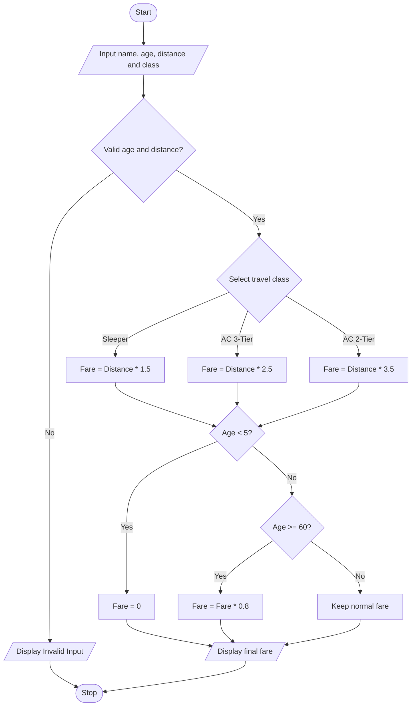

# Problem Statement
Develop a Python program to calculate railway ticket fares based on the passenger's age, travel distance, and travel class. The program should accept the passenger's name, age, distance in kilometres, and travel class as input. The fare is calculated using the following sample rates:
- Sleeper Class: ₹1.50 per kilometre
- AC 3-Tier: ₹2.50 per kilometre
- AC 2-Tier: ₹3.50 per kilometre
Passengers aged below 5 years travel free, while passengers aged 60 years and above receive a 20% discount. The program should display the passenger's details and the final ticket fare.
# Algorithm
1. Start.
2. Input passenger name, age, travel distance, and travel class.
3. Check whether age and distance are valid.
4. Calculate the fare according to the selected travel class.
5. If age is below 5 years, set the fare to zero.
6. If age is 60 years or above, apply a 20% discount.
7. Otherwise, charge the normal fare.
8. Display passenger details and final fare.
9. Stop.
# Mermaid Flowchart

# Input Source Code (Python)

# Railway Fare and Reservation Calculator

name = input("Enter passenger name: ")
age = int(input("Enter passenger age: "))
distance = float(input("Enter distance in km: "))

print("Classes: Sleeper, AC3, AC2")
travel_class = input("Enter travel class: ").lower()

if age < 0 or distance <= 0:
    print("Invalid input")

elif travel_class not in ["sleeper", "ac3", "ac2"]:
    print("Invalid travel class")

else:
    if travel_class == "sleeper":
        fare = distance * 1.5
    elif travel_class == "ac3":
        fare = distance * 2.5
    else:
        fare = distance * 3.5

    if age < 5:
        fare = 0
    elif age >= 60:
        fare = fare * 0.80

    print("\nPassenger Name:", name)
    print("Age:", age)
    print("Distance:", distance, "km")
    print("Travel Class:", travel_class.upper())
    print("Final Ticket Fare: Rs.", round(fare, 2))

# Sample Input and Output
Input:
Enter passenger name: Charitha
Enter passenger age: 65
Enter distance in km: 200
Classes: Sleeper, AC3, AC2
Enter travel class: ac3

Output:
Passenger Name: Charitha
Age: 65
Distance: 200.0 km
Travel Class: AC3
Final Ticket Fare: Rs. 400.0

Calculation:
- Normal AC 3-Tier fare = 200 × ₹2.50 = ₹500
- Senior citizen discount = 20% of ₹500 = ₹100
- Final fare = ₹500 − ₹100 = ₹400
