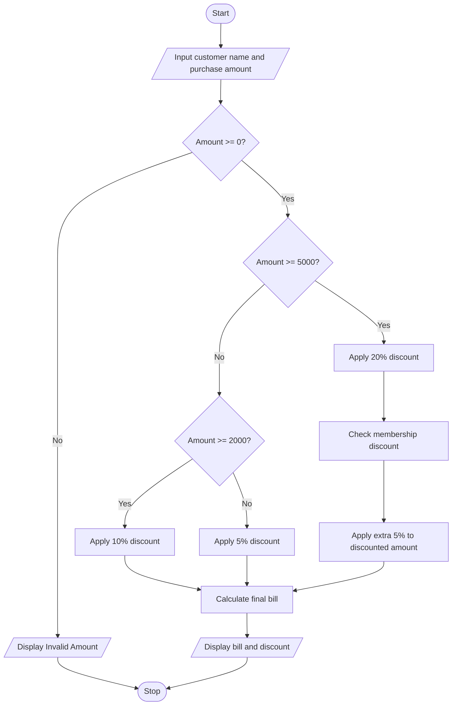

# Problem Statement
Develop a Python program to calculate a customer's final retail bill using multiple discount rules. The program should accept the customer's name and total purchase amount as input. Apply the following discount rules:
- Purchase amount of ₹5,000 or more: 20% discount.
- Purchase amount of ₹2,000 or more but less than ₹5,000: 10% discount.
- Purchase amount below ₹2,000: 5% discount.
- If the purchase amount is ₹5,000 or more, apply an additional 5% discount for membership.
The program should display the customer's name, original amount, discount amount, and final bill amount.
# Algorithm
1. Start.
2. Input the customer's name.
3. Input the total purchase amount.
4. Check whether the purchase amount is valid.
5. If the amount is ₹5,000 or more, apply a 20% discount.
6. If the amount is ₹2,000 or more but less than ₹5,000, apply a 10% discount.
7. Otherwise, apply a 5% discount.
8. If the purchase amount is ₹5,000 or more, apply an additional 5% membership discount on the amount remaining after the first discount.
9. Calculate the total discount and final bill.
10. Display the original amount, total discount, and final bill.
11. Stop.
# Mermaid Flowchart

# Input Source Code (Python)

# Retail Billing with Multiple Discount Rules

name = input("Enter customer name: ")
amount = float(input("Enter purchase amount: Rs. "))

if amount < 0:
    print("Invalid purchase amount")

else:
    if amount >= 5000:
        discount_rate = 0.20
    elif amount >= 2000:
        discount_rate = 0.10
    else:
        discount_rate = 0.05

    discount = amount * discount_rate
    discounted_amount = amount - discount

    if amount >= 5000:
        member_discount = discounted_amount * 0.05
    else:
        member_discount = 0

    total_discount = discount + member_discount
    final_bill = amount - total_discount

    print("\nCustomer Name:", name)
    print("Original Amount: Rs.", round(amount, 2))
    print("Discount Amount: Rs.", round(total_discount, 2))
    print("Final Bill: Rs.", round(final_bill, 2))

# Sample Input and Output
Input:
Enter customer name: Charitha
Enter purchase amount: Rs. 6000

Output:
Customer Name: Charitha
Original Amount: Rs. 6000.0
Discount Amount: Rs. 1740.0
Final Bill: Rs. 4260.0

Calculation:
- Original amount = ₹6,000
- First discount = 20% of ₹6,000 = ₹1,200
- Amount after first discount = ₹6,000 − ₹1,200 = ₹4,800
- Additional membership discount = 5% of ₹4,800 = ₹240
- Total discount = ₹1,200 + ₹240 = ₹1,440
- Final bill = ₹6,000 − ₹1,440 = ₹4,560
Correction: The correct output is a total discount of ₹1,440 and a final bill of ₹4,560.
