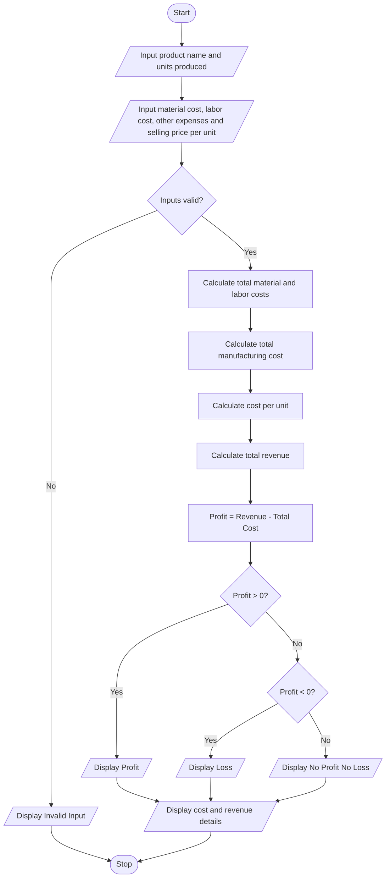

# Problem Statement
Develop a Python program to calculate the total manufacturing cost and profit of a product. The program should accept the product name, number of units produced, cost of raw materials per unit, labor cost per unit, and other expenses. Calculate the total manufacturing cost, cost per unit, total selling revenue, and profit or loss based on the selling price per unit.

Use the following formulas:
- Total manufacturing cost = Raw material cost + Labor cost + Other expenses
- Cost per unit = Total manufacturing cost ÷ Number of units produced
- Total revenue = Selling price per unit × Number of units produced
- Profit or Loss = Total revenue − Total manufacturing cost
# Algorithm
1. Start.
2. Input the product name.
3. Input the number of units produced.
4. Input raw material cost per unit, labor cost per unit, other expenses, and selling price per unit.
5. Check whether all inputs are valid.
6. Calculate total raw material cost.
7. Calculate total labor cost.
8. Calculate total manufacturing cost.
9. Calculate cost per unit.
10. Calculate total selling revenue.
11. Calculate profit or loss.
12. Display the total manufacturing cost, cost per unit, revenue, and profit or loss.
13. Stop.
# Mermaid Flowchart

# Input Source Code (Python)

# Manufacturing Cost and Profitability Analysis

product = input("Enter product name: ")
units = int(input("Enter number of units produced: "))

if units <= 0:
    print("Invalid number of units")

else:
    material = float(input("Enter raw material cost per unit: Rs. "))
    labor = float(input("Enter labor cost per unit: Rs. "))
    other = float(input("Enter other expenses: Rs. "))
    selling_price = float(input("Enter selling price per unit: Rs. "))

    if material < 0 or labor < 0 or other < 0 or selling_price < 0:
        print("Invalid cost or selling price")

    else:
        total_material = material * units
        total_labor = labor * units

        total_cost = total_material + total_labor + other
        cost_per_unit = total_cost / units
        revenue = selling_price * units
        profit = revenue - total_cost

        print("\nProduct Name:", product)
        print("Total Manufacturing Cost: Rs.", round(total_cost, 2))
        print("Cost Per Unit: Rs.", round(cost_per_unit, 2))
        print("Total Revenue: Rs.", round(revenue, 2))

        if profit > 0:
            print("Profit: Rs.", round(profit, 2))
        elif profit < 0:
            print("Loss: Rs.", round(abs(profit), 2))
        else:
            print("No Profit No Loss")

# Sample Input and Output
Input:
Enter product name: Chairs
Enter number of units produced: 100
Enter raw material cost per unit: Rs. 200
Enter labor cost per unit: Rs. 100
Enter other expenses: Rs. 5000
Enter selling price per unit: Rs. 400

Output:
Product Name: Chairs
Total Manufacturing Cost: Rs. 35000.0
Cost Per Unit: Rs. 350.0
Total Revenue: Rs. 40000.0
Profit: Rs. 5000.0

Calculation:
- Total material cost = 100 × ₹200 = ₹20,000
- Total labor cost = 100 × ₹100 = ₹10,000
- Total manufacturing cost = ₹20,000 + ₹10,000 + ₹5,000 = ₹35,000
- Cost per unit = ₹35,000 ÷ 100 = ₹350
- Total revenue = 100 × ₹400 = ₹40,000
- Profit = ₹40,000 − ₹35,000 = ₹5,000

    
    While dragging, use the arrow keys to move the item.
    Press space again to drop the item in its new position, or press escape to cancel.
