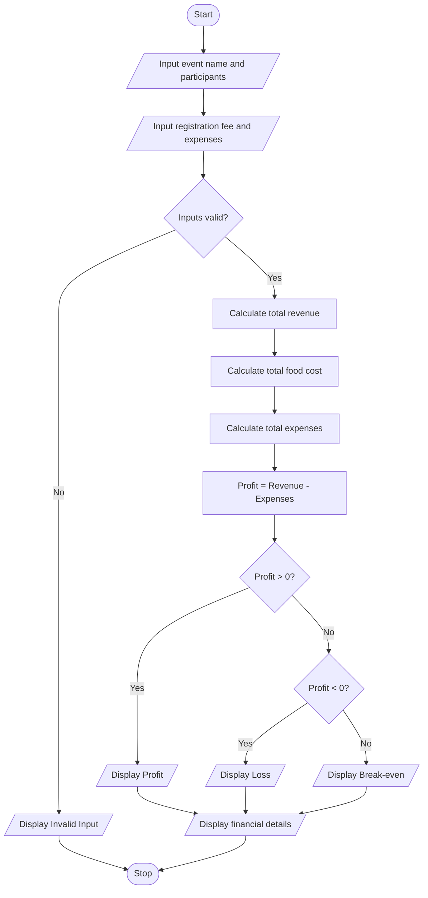

# Problem Statement
Develop a Python program to calculate the total expenses, revenue, and profit or loss for a campus event. The program should accept the event name, number of participants, registration fee per participant, venue cost, food cost per participant, and other expenses as input. Calculate the total revenue from registration fees and the total event expenses. Finally, determine whether the event generates a profit, incurs a loss, or breaks even, and display the financial details.

Formulas:
- Total Revenue = Number of Participants × Registration Fee
- Food Cost = Number of Participants × Food Cost per Participant
- Total Expenses = Venue Cost + Food Cost + Other Expenses
- Profit or Loss = Total Revenue − Total Expenses
  # Algorithm
1. Start.
2. Input the event name.
3. Input the number of participants.
4. Input the registration fee per participant.
5. Input the venue cost, food cost per participant, and other expenses.
6. Check whether the inputs are valid.
7. Calculate total revenue.
8. Calculate total food cost.
9. Calculate total expenses.
10. Calculate profit or loss.
11. If profit is positive, display profit.
12. If profit is negative, display loss.
13. Otherwise, display break-even.
14. Display the event's financial details.
15. Stop.
# Mermaid Flowchart

# Input Source Code (Python)

# Campus Event Financial Planning

event = input("Enter event name: ")
participants = int(input("Enter number of participants: "))

if participants < 0:
    print("Invalid number of participants")
else:
    registration_fee = float(input("Enter registration fee per participant: Rs. "))
    venue_cost = float(input("Enter venue cost: Rs. "))
    food_cost = float(input("Enter food cost per participant: Rs. "))
    other_expenses = float(input("Enter other expenses: Rs. "))

    if (registration_fee < 0 or venue_cost < 0
            or food_cost < 0 or other_expenses < 0):
        print("Invalid expense or fee")

    else:
        revenue = participants * registration_fee
        total_food_cost = participants * food_cost
        total_expenses = venue_cost + total_food_cost + other_expenses
        profit = revenue - total_expenses

        print("\nEvent Name:", event)
        print("Total Revenue: Rs.", round(revenue, 2))
        print("Total Food Cost: Rs.", round(total_food_cost, 2))
        print("Total Expenses: Rs.", round(total_expenses, 2))

        if profit > 0:
            print("Event Profit: Rs.", round(profit, 2))
        elif profit < 0:
            print("Event Loss: Rs.", round(abs(profit), 2))
        else:
            print("Event Break-even: No Profit, No Loss")

# Sample Input and Output
Input:
Enter event name: College Fest
Enter number of participants: 200
Enter registration fee per participant: Rs. 300
Enter venue cost: Rs. 20000
Enter food cost per participant: Rs. 100
Enter other expenses: Rs. 5000

Output:
Event Name: College Fest
Total Revenue: Rs. 60000.0
Total Food Cost: Rs. 20000.0
Total Expenses: Rs. 45000.0
Event Profit: Rs. 15000.0

# Calculation
- Total revenue = 200 × ₹300 = ₹60,000
- Total food cost = 200 × ₹100 = ₹20,000
- Total expenses = ₹20,000 + ₹20,000 + ₹5,000 = ₹45,000
- Profit = ₹60,000 − ₹45,000 = ₹15,000
